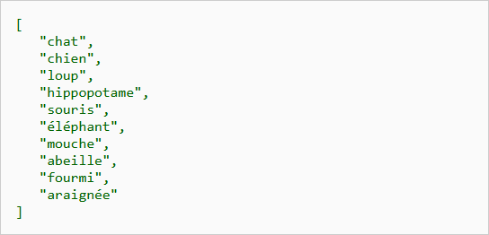
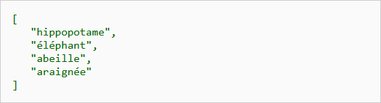

<h1><code>Module 323</code> - Programmer de manière fonctionnelle</h1>

# 😅 Exercice 06 - Composition et calculs

## Objectifs

-   Entraîner la composition.

## Rapports à produire

## C1 - Ajouter la note fédérale à toutes les évaluations effectuées

Observez avec attention [les données sur des examens réalisés](/src/ex06-data-examens.js). Il s’agit d’une liste de points obtenus à un examen de chaque étudiant d’une classe.

Ajouter la note obtenue à chaque étudiant en respectant l’**échelle fédérale** :

-   on divise le nombre de point obtenus par le nombre de points total de l’épreuve
-   on multiplie ce nombre par 5
-   on ajoute 1
-   on arrondit au demi-point

Constituer le tableau HTML montrant les examens réalisés avec la note officielle. **Utilisez les fonctions unaires (map, filtre, reduce, etc.) que vous connaissaisez pour faire cela**. Vous devriez obtenir ceci :

## C2 - Calculer les notes fédérales des examens et les afficher (currying)

Refaire le même travail qu'au point 1 mais cette fois en utilisant la notion de **currying**. Déclarer impérativement une fonction **calculerNote** permettant d'établir la note d'un élève en fonction du nombre de points maximal et le nombre de point obtenus. Les fonctions déclarées doivent **unaires**, c'est à dire qu'elle doivent avoir un seul paramètre.

Utiliser ensuite cette fonction pour établir la liste des élèves avec leurs points et la note correspondande.

Le tableau HTML montrant les examens réalisés avec la note officielle sera le même qu'au point 1.

## C3 / C4 - Générateur de filtres par seuil

Définir une fonction _closure_ appelée **makeFilterByMinLength** à qui l'on passe le nombre minimum de caractères qu'un mot doit contenir et qui retourne une fonction permettant de filtrer une liste de mots passée en paramètre en fonction du nombre minimal sauvegardé dans le contexte de la closure.

Sur la base de la closure **makeFilterByMinLength**, déclarer une fonction **filtreCourts** et **filtreLongs** permettant de considérer respectivement les mots de plus de 3 et 6 caractères.

Les boutons **C3 - Afficher les mots dont la longueur est supérieur à 3 caractère** et **C4 - Afficher les mots dont la longueur est supérieur à 6 caractère** permettront d'afficher les listes filtrées.

 

---

